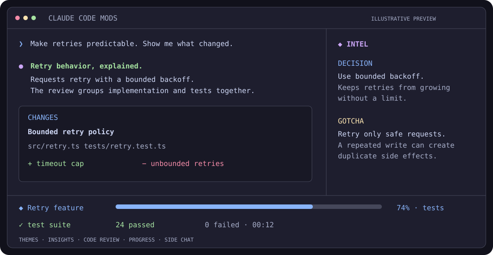

<div align="center">

# Claude Code Mods

**Keep the context. See the changes. Follow the work.**

11 independently installable mods for Claude Code: richer replies, living session insights,
concept-based code review, progress bands, side chat, and workflow tools.

[](https://github.com/sruthik27/claude-code-mods/actions/workflows/ci.yml)
[](LICENSE)
[](https://code.claude.com/docs/en/plugins/mods)
[](https://github.com/sruthik27/claude-code-mods/releases)

[Quick start](#install) · [Browse the mods](#choose-your-mods) · [Documentation](docs/INSTALL.md) · [Report a bug](https://github.com/sruthik27/claude-code-mods/issues/new/choose)



*Illustrative preview, not a captured Claude session. Actual appearance depends on your terminal and theme.*

</div>

## Install

Use **Claude Code 2.1.296 or newer**. Start with five visual and review mods:

```bash
claude plugin install starter-kit --marketplace sruthik27/claude-code-mods
```

That installs **Lumen, Insight Pane, Changes, Goal Meter, and Live Progress** through Claude's plugin manager.
Run `/reload-plugins` in an open Claude session, or start a new session.
Try `/lumen demo`, `/intel`, and `/changes`.

For the complete collection:

```bash
claude plugin install all-mods --marketplace sruthik27/claude-code-mods
```

Or install just one:

```bash
claude plugin install lumen --marketplace sruthik27/claude-code-mods
```

You can also enter `/plugin install starter-kit --marketplace sruthik27/claude-code-mods` inside Claude Code.
The source code is MIT licensed and free to install. Model-backed features use your own Claude Code model access and usage.

## Choose your mods

| Mod | What it adds | Start here |
| :--- | :--- | :--- |
| [**Lumen**](mods/lumen) | Themes, highlighted code, tables, animated Mermaid diagrams, timelines, state machines and sparklines | `/lumen demo` |
| [**Insight Pane**](mods/insight-pane) | A living Intel pane of concepts, decisions, root causes, gotchas, facts and open risks | `/intel` |
| [**Changes**](mods/changes) | Review edits by concept → file → symbol; select code to ask a question or request a change; inspect branch diffs | `/changes` |
| [**Goal Meter**](mods/goal-meter) | Overall goal progress, phases, task counts and elapsed time | Automatic |
| [**Live Progress**](mods/live-progress) | Log-backed progress for tests and long jobs, including failures | Ask Claude to watch a job's log |
| [**Aside**](mods/aside) | Read-only side chat about the session, without adding questions to the main thread | `/aside what changed?` |
| [**Session Namer**](mods/session-namer) | Session names based on the work, while respecting titles you set | Automatic |
| [**Find Sess**](mods/find-sess) | Find a previous session by describing what you remember | `/find-sess upload retry` |
| [**Skills**](mods/skills) | Suggestions from your installed skills, shown below the prompt | Automatic |
| [**MCP Control**](mods/mcp-control) | List, enable with approval, or reconnect configured MCP servers | Ask Claude to list MCP servers |
| [**Self-drive · experimental**](mods/self-drive) | Continue a task while you are away, journal decisions, and hold recognized risky actions | `/self-drive 30m <task>` |

Every mod is available separately. Lumen is optional for the panes; they have native rendering fallbacks.
Self-drive starts only when you explicitly invoke its command.

## A few things to know

- **Where it draws:** terminal Claude Code is the primary target. Claude Desktop's Code tab supports mod UI with surface-specific limits. VS Code's chat panel and headless sessions do not show these panes or bands. See [compatibility](docs/INSTALL.md#compatibility).
- **Model usage:** insights, edit labels, skill suggestions, session names, session search, and Aside can make extra model calls. They consume your plan/API usage and some hooks await their results. See [behavior and data](docs/BEHAVIOR.md).
- **Permissions:** mods run with your account's permissions. Self-drive's pattern guards are not a shell sandbox. Its deadline blocks new tool calls, but cannot terminate an already running process or agent.
- **Renderer conflicts:** disable an existing Prismantis renderer before enabling Lumen, and disable upstream Aside before enabling this fork.
- **Public beta:** offline tests and installation checks are automated. Live model behavior and actual terminal painting still need real-session testing; Windows is not verified. See [validation](docs/VALIDATION.md).

## Updates and removal

```bash
claude plugin update starter-kit@claude-code-mods
claude plugin update lumen@claude-code-mods
claude plugin disable lumen@claude-code-mods
claude plugin uninstall lumen@claude-code-mods
```

Marketplace auto-update is opt-in. Bundles install other plugins: removing a bundle does not promise to remove every dependency; inspect `/plugin` and remove or prune unused plugins. [Full installation guide](docs/INSTALL.md).

## Develop and contribute

```bash
git clone https://github.com/sruthik27/claude-code-mods
cd claude-code-mods
python3 scripts/check.py
```

Tests require Claude Code, Node.js 22.18+ and Python 3. No sign-in or API key is required for offline tests.
See [CONTRIBUTING.md](CONTRIBUTING.md) for the structure, checks, and release process.
Bug reports and focused pull requests are welcome.

## Credits and licence

Maintained by [Sruthik Issac](https://github.com/sruthik27). MIT licensed.

- **Lumen** is a fork of [Nahum Litvin's Prismantis](https://github.com/NahumLitvin/prismantis), with its original copyright retained. [Licence](mods/lumen/LICENSE) · [Third-party notices](mods/lumen/docs/THIRD_PARTY_NOTICES.md).
- **Aside** is a restyled fork of [JayDoubleu's Aside](https://github.com/JayDoubleu/aside), with its original MIT licence retained. [Licence](mods/aside/LICENSE).

This is an independent community project, unaffiliated with Anthropic.
