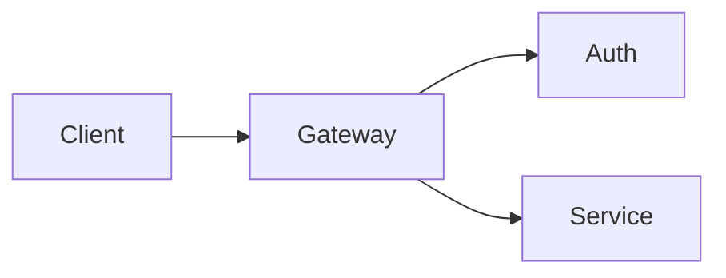

# lumen

```bash
claude plugin install lumen --marketplace sruthik27/claude-code-mods
```

Requires Claude Code 2.1.296+. See [installation and compatibility](../../docs/INSTALL.md).

Colourful, themeable rendering for Claude Code replies, now with **animated diagrams**: a Claude Code mod
that redraws markdown in the terminal with themes, highlighted code, boxed tables, mermaid diagrams and
charts, and explains flows step by step with diagrams that play.

lumen is a fork of [prismantis](https://github.com/NahumLitvin/prismantis) by Nahum Litvin (MIT). Everything
prismantis does is still here; see "What lumen adds" for the new parts.

## What lumen adds

| Write this | You see |
|---|---|
| `%% step A->B "request"` lines in a ```` ```mermaid ```` flowchart | the diagram **plays**: a dot travels each step along the drawn lines, the step's boxes go bold, the caption shows below. Click or space pauses, ←/→ steps, `r` restarts |
| `%% animate` in a `sequenceDiagram` (or a flowchart) | every message (or edge) plays in order |
| a mermaid `gantt` block | coloured timeline bars: done ✓, active ◂, critical in red, milestones ◆, `after` dependencies, a dated axis |
| a `stateDiagram-v2` block | drawn as a clean flowchart with start and end circles and labelled transitions |
| `{spark: 3 5 9 4 12}` in text or a table cell | an inline sparkline `▁▃▆▂█` |
| a 60-line code block | folded to 12 lines with a `▸ 48 more lines` button |
| a flowchart or sequence diagram too wide for your terminal | redrawn top-down, or as a numbered message list, rather than raw source |

Claude is told about all of these with each prompt you type, along with your terminal width, so it uses them
when a picture helps. Animations run only while the reply is on screen and stop after two plays; headless runs
and copies get the still diagram.



## Install

lumen is a local mod: put the folder in Claude Code's mod path.

```bash
cp -R lumen ~/.claude/mods/lumen
# add ~/.claude/mods/lumen to CLAUDE_CODE_PLUGIN_DIRS in ~/.claude/settings.json (install.sh in the repo root does both)
```

If you also have prismantis installed, disable it so the two don't both draw replies:

```bash
claude plugin disable prismantis@prismantis
```

Start a new session. `/lumen` shows the commands, `/lumen demo` the full showcase.

## Reference

### Themes

Dark: `catppuccin-mocha` (default), `dracula`, `nord`, `tokyo-night`, `gruvbox-dark`, `rose-pine`, `everforest`, `github-dark`, `one-dark`, `solarized-dark`.

Light: `catppuccin-latte`, `gruvbox-light`, `rose-pine-dawn`, `github-light`, `solarized-light`.

Switch on the spot with `/lumen theme nord`, or run `/lumen` for the help screen with every theme. `mono` uses no color, only bold and dim. Every palette is MIT licensed and credited in [THIRD_PARTY_NOTICES.md](docs/THIRD_PARTY_NOTICES.md).

### Tables

Header cells take the `tableHeader` color, and every cell sits in a box with a double line under the header (`tableStyle`: `box`, or `rules`, `grid` and `minimal` for lighter looks), and `:---:`/`---:` alignment is honored. Numbers inside cells are colored like everywhere else. Columns shrink to fit the terminal.

### Code

Code blocks get a header row with the language on the left and a copy button on the right, and the code sits indented below with no frame, so selecting it with the mouse copies only the code.

- **Prism** highlights JavaScript, TypeScript, JSX/TSX, Python, Go, Rust, Java, Kotlin, Swift, C, C++, C#, Ruby, JSON, YAML, TOML, SQL, HTML, CSS, Dockerfile, HCL and diff: keywords, strings, numbers, comments, keys, functions and properties each get a theme color.
- **Shell** blocks (`bash`, `sh`, `zsh`, unlabeled) color the command word, `--flags`, quoted strings and `# comments`, and restart after `|`, `&&` and `;`.

### Diagrams and charts

Code blocks tagged `mermaid` draw as colored text art:

- flowcharts (`graph LR`, `graph TD`, decisions), sequence, state, class and ER diagrams
- bar and line charts with `xychart-beta`, sized to the terminal width
- each box and participant gets its own theme color, the same at both ends of a sequence diagram
- each bar gets its own color, gridlines stay dim, axis numbers use the number color

Diagrams too wide for the window, or over 80 lines, stay as code. `mermaidAscii` swaps box-drawing characters for `+ - |`. Pie charts are not supported.

### Layout

When tables and diagrams follow each other, they share a row and wrap to the next line once the terminal runs out of width. A wide terminal shows a table, a flowchart and two charts side by side.

### Copy buttons

`[ ⧉ copy ]`, drawn in Claude Code's accent color, sits on code blocks, tables, lists and quotes and puts the raw markdown on your clipboard. Quotes copy without their `> ` markers, ready to paste as a message. Diagrams get two: `⧉ source` copies the mermaid code and `⧉ art` copies the drawn art, ready to paste into a chat code block. Tables get `⧉ art` too: a plain boxed table that reads right in Slack, where pasted markdown does not. Replies end with `⧉ copy reply`, which copies the reply as Claude wrote it (one-line English narration gets none). Use it for Hebrew and Arabic: selecting right-to-left text on screen copies the letters in the order they are drawn, not the order they are read. Clicking works where the terminal passes clicks through (fullscreen mode does); terminals with copy-on-select, such as Warp, may grab the word "copy" instead. Without a mouse, `/lumen copy` copies the last reply and `/lumen copy code` its last code block. Since Claude Code 2.1.291 `ctrl+x` then `tab` focuses the area above the prompt, not the buttons in replies.

### Tool rows

Each tool call draws as one line: a bold verb and its target, `Ran` with a colored shell command, `Read` and `Edited` with the path. The dot is green when done, hollow while running and red on failure. Output still draws below. Collapsed groups draw one line too, `Ran 3 commands, read 2 files · last: npm test`, with a red count when any call failed. Expand a group (ctrl+o or `--verbose`) and its calls draw with Claude Code's own rows, inline output included.

`toolStyle` keeps tool rows apart from what Claude says. The default, `chat`, puts them dimmed on the right, like the other side of a chat, and leaves Claude's sentences on the left. Rows are capped at 60% of the width.

`tree-dim` tucks them under the sentence with `⎿` and dims them.

`tree-bold` is `tree-dim` with one-line sentences in bold.

`classic` is the original look: a bold verb and a status dot, at full brightness.

### Turn footer

The line that closes a turn keeps Claude Code's word and colors the duration: `✻ Baked for 6m 20s`. Terminal only, since that's the only surface that draws it.

### Slash commands

Output from slash commands, built-in or from other plugins, is parsed as markdown and drawn like a reply, copy buttons included. Errors keep Claude Code's own red line.

### Other mods

A mod that draws markdown in its own pane or band can have lumen draw it, in the user's theme, by calling `$.lumen.markdown` with the surface, the text and the columns it has.

- It answers the tree to draw, or `undefined` when lumen is disabled or the text holds nothing to draw.
- It throws when lumen isn't installed, so call it in a `try`.
- `columns` is the width of your content. Lumen draws at least 20 columns wide.
- Theme, RTL and number and path highlighting follow the user's lumen settings.
- Copy buttons are left out, because a button can't cross from one mod to another.

```tsx
let drawn
try {
  drawn = await $.lumen.markdown({ surface: e.surface, text, columns: e.props.bodyColumns })
} catch {}
return drawn ?? <Markdown text={text} />
```

The types are in [types/index.d.ts](types/index.d.ts). List lumen under `dependencies` in your `plugin.json` to have Claude Code lay them into your `.claude-plugin/types/`. When lumen is optional, declare the noun in your own contract instead:

```ts
declare module 'claude-code' {
  interface EngineInterface {
    lumen: {
      markdown: (args: { surface: RenderSurface; text: string; columns: number }) => Promise<RenderElement | undefined>
    }
  }
}
```

### Diagram hints

Claude rarely writes a chart unless it knows the terminal can draw one. With `diagramHints` on (the default), lumen attaches a short note to each prompt you type, read by the model and never shown, saying tables, alerts, code, mermaid diagrams and `xychart-beta` charts render here and to use one when a numeric series or a flow is easier to see than read. It also asks for commands in fenced blocks, since only those get a copy button. It costs about 190 tokens per prompt. It's off whenever `mermaid` is off, and skipped for headless `claude -p` runs and background notifications. Claude Code doesn't let installed plugins edit the system prompt (its built-in `sec-default` policy keeps that for the organization), so the note rides along with your prompt instead.

### Text

**Bold**, *italic*, ~~strikethrough~~, `inline code`, links and bare URLs, clickable as terminal hyperlinks (where the terminal has none, the URL shows dimmed after the text). Numbers, versions (`v2.14.0`), durations (`250ms`, `3h`), sizes (`16Gi`) and percentages (`99.9%`) take the number color, and paths like `~/src/app.ts` the path color.

### Headings, lists, quotes

`headingStyle` picks `banner` (the default: a box around H1, a heavy rule under H2), `bold`, `underline` or `uppercase`. Terminals have one font size, so headings stand out through style and color. Lists keep their numbers and nest with `•` and `◦`. Quotes get an accent bar, and GitHub alerts (`> [!NOTE]`, `[!TIP]`, `[!IMPORTANT]`, `[!WARNING]`, `[!CAUTION]`) draw as colored boxes. Single-series bar charts print each value above its bar and color the tallest one.

Task lists draw as `[ ]` and `[✓]`, with done items dimmed and struck through. `taskStyle` switches to `ticks` (`○` `✓`), `box` (`□` `✓`) or `progress`, which adds a done-count bar above each list.

### Your prompts

What you type, at the prompt or through Remote Control, draws in the theme's colors. `promptStyle` picks the look, and `off` keeps Claude Code's own. Task notifications and teammate messages are left alone.

| `bubble` (default) | `bar` | `chevron` |
|---|---|---|
| Rounded prompt bubble | Accent border | Bold chevron |

### Right to left

Hebrew and Arabic blocks are right aligned, with bullets, numbers and quote bars on the right and table columns mirrored, while code, numbers, paths and links stay left to right inside them. Terminals differ in how they treat right-to-left letters, so lumen detects yours and sends the letters the way it needs them. `/lumen demo-rtl` shows every element, and the `rtl` option forces a terminal's handling or turns it off.

## Configure

Open `/config` and look for the **lumen** rows, or set values in `~/.claude/settings.json`:

```json
{
  "pluginConfigs": {
    "lumen": {
      "theme": "tokyo-night",
      "tableStyle": "grid",
      "headingStyle": "banner",
      "tableHeaderColor": "#ffcc00",
      "numberColor": "cyan"
    }
  }
}
```

| Option | Values | Default |
| --- | --- | --- |
| `enabled` | `true`, `false` | `true` |
| `theme` | see [Themes](#themes) | `catppuccin-mocha` |
| `tableStyle` | `box`, `rules`, `grid`, `minimal` | `box` |
| `taskStyle` | `checks` (`[ ]` `[✓]`, done struck through), `ticks` (`○` `✓`), `box` (`□` `✓`), `progress` (ticks with a done-count bar) | `checks` |
| `promptStyle` | `bubble`, `bar`, `chevron`, `off` | `bubble` |
| `headingStyle` | `banner`, `bold`, `underline`, `uppercase` | `banner` |
| `highlightNumbers` | `true`, `false` | `true` |
| `highlightPaths` | `true`, `false` | `true` |
| `toolRows` | `true`, `false` | `true` |
| `toolStyle` | `chat`, `tree-dim`, `tree-bold`, `classic` | `chat` |
| `copyButtons` | `true`, `false` | `true` |
| `diagramHints` | `true`, `false` | `true` |
| `rtl` | `auto`, a terminal (`warp`, `kitty`, `apple-terminal`, `iterm`, `ghostty`, `wezterm`, `vscode`, `alacritty`, `windows-terminal`, `gnome`, `konsole`), `off` | `auto` |
| `mermaid` | `true`, `false` | `true` |
| `mermaidAscii` | `true`, `false` | `false` |
| `<token>Color` | any color, see below | theme |

A color is hex (`#a6e3a1`, `#fc0`), `rgb(166,227,161)`, `ansi256(114)` or a name (`green`, `cyanBright`). Values that don't parse are ignored. Every token has a `<token>Color` option and a row in `/config`:

| Token | Colors |
| --- | --- |
| `accent` | reply bullet, H3+ headings, quote bar, running tool dots |
| `heading` | H1 and H2 |
| `strong` | **bold** text |
| `emphasis` | *italic* text, variables, attribute names |
| `inlineCode` | `inline code` |
| `codeText` | code block text |
| `codeCommand` | shell commands, functions, class names, keys |
| `codeFlag` | `--flags`, keywords, failures |
| `codeString` | strings |
| `codeComment` | comments, the code block's language label |
| `link` | links, URLs, properties, tags |
| `path` | file paths, regexes |
| `number` | numbers, versions, durations, done dots |
| `quote` | quote text |
| `rule` | rules, chart gridlines |
| `tableHeader` | table header cells |
| `tableRule` | table rules |
| `bullet` | list bullets and numbers |
| `diagram` | diagram lines |
| `diagramText` | diagram labels |

## Limits

- The parser covers what Claude writes (headings, lists, tables, fences, quotes, emphasis, links). It's not full CommonMark: nested quotes and HTML draw as plain text.
- Widths count CJK and emoji as two columns. Terminals disagree on a few emoji, so those can still be off by one.- Languages outside the 24 above draw in `codeText`.

## Develop

```bash
claude plugin validate .
claude plugin test .
```

`hooks/extras.ts` holds lumen's additions as pure functions (sparklines, gantt, state diagrams, animation
frames); `hooks/anim.tsx` is the animation player, a `Client` surface module; `tests/extras.test.tsx` covers them.
`scripts/build-vendor.mjs` rebuilds the vendored mermaid renderer and Prism (`cd scripts && npm install` first).

## Credits and licence

MIT. lumen is a fork of [prismantis](https://github.com/NahumLitvin/prismantis) © Nahum Litvin; the original
copyright notice is kept in [LICENSE](LICENSE). Bundled third-party code is listed in
[docs/THIRD_PARTY_NOTICES.md](docs/THIRD_PARTY_NOTICES.md).
